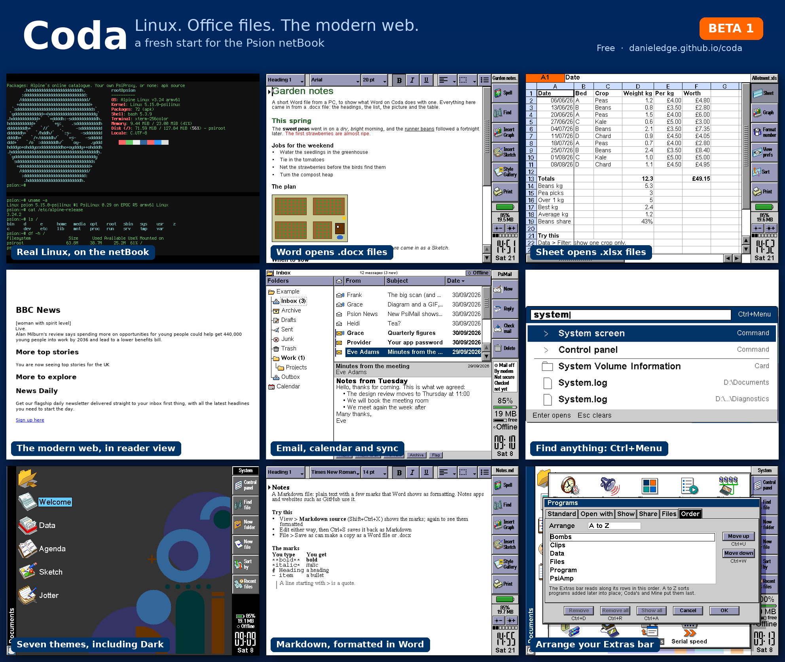

# Coda for the Psion netBook

**Your netBook, brought forward.** Coda is a modernised system for the Psion netBook: new programs for email, the web, SSH, PDFs, pictures, music and Linux, themes and smooth text, more free memory, and a lot of small fixes. It comes as one zip that you unzip onto the netBook's CompactFlash card. Psion's own system is on the card beside it, so you can always go back.

The name is a musical term: a coda is the closing passage that brings a piece to its proper end, and this finishes what Psion didn't.

## Links

| | |
|---|---|
| **[Download Coda](https://danieledge.github.io/coda/download.html)** | Every available release, ready to unzip onto the card |
| **[Install guide](https://danieledge.github.io/coda/install.html)** | Step by step, with pictures |
| **[Beta 1](https://danieledge.github.io/coda/#beta)** | What Coda is, and what to know about the first beta |
| **[The website](https://danieledge.github.io/coda/)** | Everything Coda does, chapter by chapter |
| **[The diary (blog)](https://github.com/danieledge/PsiCoda)** | A picture of every change as it was made |
| **[Releases](https://github.com/danieledge/coda/releases)** | Release notes and the zip files on GitHub |
| **[Issues](https://github.com/danieledge/coda/issues)** | Report a problem, ask a question, suggest an idea |
| **[Buy me a coffee](https://buymeacoffee.com/danedge)** | If Coda is useful to you |

## Install in short

1. **Back up your CompactFlash card** to your computer, and keep your netBook's own `OS.IMG` safe.
2. Download the Coda zip from the [Download page](https://danieledge.github.io/coda/download.html).
3. Unzip it into the card's top folder, and let it replace `OS.IMG`.
4. Eject the card properly, put it in the netBook, and start up from cold.

The [install guide](https://danieledge.github.io/coda/install.html) has the details, and how to go back to Psion's own system.

## Status

Coda Beta 1 is an early beta. It has been tried on a netBook with a serial device that behaves like a modem, and in an emulator. It has **not** been tried with a LAN (Ethernet) card yet. Expect rough edges, back up first, and use it at your own risk.

Feedback is very welcome. Please [open an issue](https://github.com/danieledge/coda/issues): what works, what doesn't, and what you would like to see.

## About this repository

This repository holds the Coda website (`index.html`, `install.html`, `download.html`) and its screenshots in `img/`. Every picture is a real screenshot of the netBook's screen, taken in the netBook emulator. The releases are on the [Releases](https://github.com/danieledge/coda/releases) page.

## Thanks and licence

Coda is built on c1.60a, the 2005 community bug-fix patch for the netBook by Poke of Patisoners (CC BY-NC-SA 3.0 CZ). Like c1.60a, Coda is free and non-commercial. A lot of other people's work is in Coda too: the licences and credits are on the card in `LICENCES\`.

Coda is an unofficial project. It is not made, endorsed or supported by Psion, and is not affiliated with Psion or its owners. Psion and netBook are trademarks of their respective owners.
